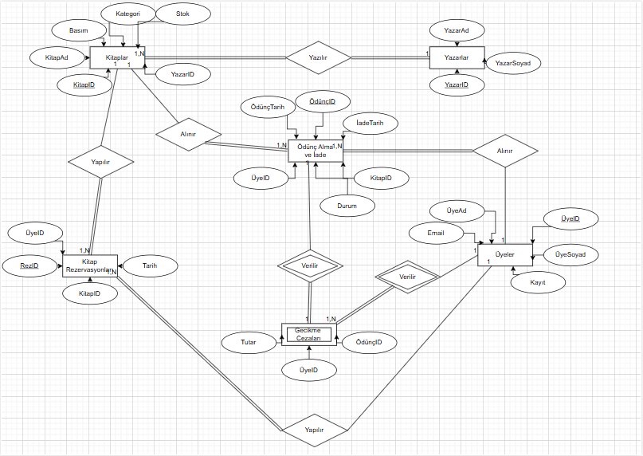
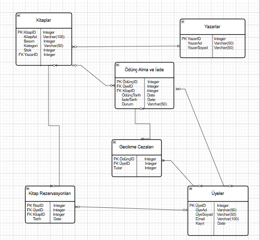

# Library Management System (SQL)

A relational database for a small library: books, authors, members, loans, reservations and late fees, with 30+ SQL queries for daily operations and simple analytics.

Course project for **END 106 Database Management**, TOBB University of Economics and Technology (Spring 2025). Team: Elçin Erkol, Deniz Geceler, Meltem Tekbıyık, Zeynep Ela Zaralı.

## Data model



The database has six tables. Table and column names are in Turkish:

| Table | Meaning | Key columns |
| --- | --- | --- |
| `Yazarlar` | Authors | `YazarID`, `Ad`, `Soyad` |
| `Kitaplar` | Books | `KitapID`, `Ad`, `Basim` (year), `Kategori`, `Stok`, `YazarID` → Yazarlar |
| `Uyeler` | Members | `UyeID`, `Ad`, `Soyad`, `Email` (unique), `Kayit` (sign-up date) |
| `Odunc` | Loans | `OduncID`, `UyeID`, `KitapID`, `Tarih`, `IadeTarih` (return date), `Durum` (status) |
| `Rezervasyon` | Reservations | `RezID`, `UyeID`, `KitapID`, `Tarih` |
| `Ceza` | Late fees | `OduncID`, `UyeID`, `Tutar` (amount) |

Foreign keys use `ON DELETE CASCADE` / `SET NULL` so that deleting a member or book does not leave broken records. Loan status is limited by a `CHECK` constraint.



## What the queries do

- **Members:** list members, a member's loan history, latest book borrowed, members who joined in the last year, members with the most loans or delays
- **Books and authors:** books by author or category, most borrowed books and authors, average age of the collection, out-of-stock books (stock is reduced after each loan), number of categories
- **Reservations:** active reservations, reservations about to expire (day 28 warning, day 30 expiry), reserved but never borrowed books
- **Late fees:** 30-day loan period, 50 TL per late day; lists late loans with their fee and the total fee amount
- **Business rules:** members with 2+ cancelled reservations, and members more than 300 days late, are flagged and no longer allowed to borrow

## How to run

Written for **MySQL 8**. Open `library_management.sql` in MySQL Workbench (or run `mysql -u root -p < library_management.sql`). The script creates the `END106` database, the tables and sample data, then runs the queries in order.

## Files

```
library_management.sql      Schema, sample data and all queries
docs/er_diagram.png         ER diagram
docs/database_schema.png    Relational schema
docs/project_report_tr.pdf  Project report (Turkish)
```
